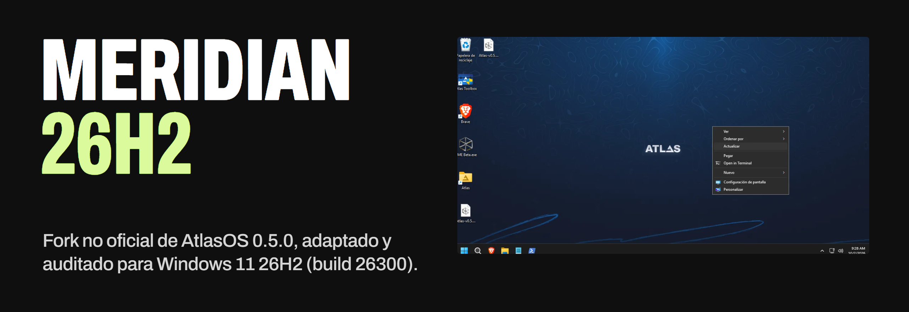

<p align="center">
  <a href="https://zykmm.github.io/meridian-26h2/"></a>
</p>

<p align="center">
  <a href="https://github.com/zykmm/meridian-26h2/releases/latest"></a>
  <a href="https://github.com/zykmm/meridian-26h2/actions/workflows/build.yml"></a>
  <a href="https://github.com/zykmm/meridian-26h2/releases"></a>
  <a href="https://github.com/zykmm/meridian-26h2/stargazers"></a>
  
  <a href="LICENSE"></a>
</p>

<p align="center">
  <a href="https://zykmm.github.io/meridian-26h2/"><b>Web</b></a> ·
  <a href="https://zykmm.github.io/meridian-26h2/en/"><b>English</b></a> ·
  <a href="https://github.com/zykmm/meridian-26h2/releases/latest"><b>Descargar</b></a> ·
  <a href="https://zykmm.github.io/meridian-26h2/guia/instalar-atlasos-windows-11-26h2/"><b>Guía de instalación</b></a> ·
  <a href="CAMBIOS-26H2.md"><b>Registro de cambios</b></a> ·
  <a href="https://github.com/zykmm/meridian-26h2/issues/new/choose"><b>Reportar un error</b></a>
</p>

> [!IMPORTANT]
> **Meridian 26H2 es un fork NO oficial de [AtlasOS](https://github.com/Atlas-OS/Atlas).** No pertenece al equipo de Atlas ni está respaldado por él. Los errores de Meridian se reportan [aquí](https://github.com/zykmm/meridian-26h2/issues), nunca a Atlas. Si usas Windows 11 24H2 o 25H2, instala el [AtlasOS oficial](https://atlasos.net).

## Qué es

**Meridian 26H2 es la forma de usar AtlasOS en Windows 11 26H2.** Sirve para optimizar Windows 11, quitar bloatware y telemetría (*debloat*), ganar rendimiento en juegos y mejorar la privacidad, sin reinstalar el sistema.

AtlasOS 0.5.0 se publicó para Windows 11 24H2 y 25H2. **Meridian 26H2** toma ese playbook (commit [`6c26aab`](https://github.com/Atlas-OS/Atlas/commit/6c26aab)) y lo lleva a **Windows 11 26H2 (build 26300)**, con la misma idea: más rendimiento, más privacidad y menos molestias, sin romper lo que hace falta.

No es una ISO modificada. Es un *playbook* de [AME Wizard](https://ameliorated.io): un ZIP de archivos de texto (YAML, PowerShell y `.cmd`) que se aplica sobre tu Windows ya instalado. Todo lo que hace está en [`src/playbook`](src/playbook) y se puede leer antes de instalarlo.

Para 26H2 se revisó el playbook entero: 190 archivos YAML, más de 800 acciones y todos los scripts. Cada cambio está apuntado con su motivo en [`CAMBIOS-26H2.md`](CAMBIOS-26H2.md).

## Qué cambia respecto a AtlasOS 0.5.0

| Cambio | ID | Qué pasaba en 0.5.0 sobre 26H2 |
|---|---|---|
| Widgets y navegador predeterminado se aplican **tras el reinicio** (`postReboot.ps1`) | F3-1, F3-21 | UCPD bloqueaba las directivas de Widgets y las asociaciones del navegador durante la instalación |
| El bloqueo de versión de Windows Update **funciona** | B2-3 | La versión se escribía como texto encima de `TargetReleaseVersion` y Windows lo ignoraba |
| `Remove-Edge.exe` fijado a la versión 2.3 y **comprobado con SHA256** | B1-1 | Se descargaba la última versión sin comprobarla y pedía confirmación a mitad de la instalación |
| Copilot se quita **sin dejar 1,1 GB de restos** | F5-5 | Quedaban su app Chromium, un servicio, claves de registro y un acceso directo |
| Asistencia remota se desactiva en **cualquier idioma** | F3-4 | Las reglas del firewall se buscaban por su nombre en inglés y en Windows en español no se encontraban |
| Quick Assist y CrossDevice retirados; los frameworks se respetan | D4, F3-8 | Se desaprovisionaba `Microsoft.WindowsAppRuntime` por error |
| `DEFAULT.ps1` corre en instalación limpia y **respeta tus opciones** | D1 | Solo corría al actualizar, y la carpeta Atlas no reflejaba lo elegido en el asistente |
| La carpeta Atlas usa los estados reales de **Atlas Toolbox 0.1.13** | F3-13 | Toolbox mostraba opciones que no coincidían con lo aplicado |
| Uso compartido, Core Isolation, AutoPlay, Spotlight, mitigaciones… | varios | 79 cambios documentados en total; todos en [`CAMBIOS-26H2.md`](CAMBIOS-26H2.md) |

## Requisitos

- **Windows 11 26H2, build 26300**, con todas las actualizaciones instaladas. El asistente rechaza cualquier otra build.
- La última versión de **[AME Wizard](https://ameliorated.io)**.
- Conexión a Internet y el equipo enchufado a la corriente.
- Sin antivirus de terceros. AME Wizard te guía para desactivar temporalmente Defender y UCPD.
- **Una copia de seguridad.** Meridian no tiene desinstalador: para volver a Windows sin modificar hay que reinstalarlo.

## Instalación

1. Descarga `Meridian-26H2-vX.Y.Z.apbx` y su `.sha256` desde la [última versión](https://github.com/zykmm/meridian-26h2/releases/latest). El análisis de la v1.0.0 en [VirusTotal](https://www.virustotal.com/gui/file/51b598dffa3e25002924ff869c02af011fc48182260bb770fd13d105bb24a8ea) da 0 de 62.
2. Comprueba la descarga en PowerShell:
   ```powershell
   (Get-FileHash .\Meridian-26H2-v1.0.0.apbx -Algorithm SHA256).Hash
   ```
   Tiene que coincidir con el contenido del archivo `.sha256`.
3. Abre AME Wizard y arrastra el `.apbx` a la ventana.
4. Sigue el asistente: comprobará los requisitos y te dejará elegir Defender, mitigaciones, actualizaciones automáticas, navegador y si quieres quitar Edge.
5. Espera unos 15 minutos y reinicia. Tras el primer inicio de sesión, `postReboot.ps1` aplica Widgets y el navegador predeterminado.
6. Si dejaste Defender activado, vuelve a activar la **Protección contra alteraciones**. Meridian te lo recuerda con un aviso.

Para comprobar el resultado, ejecuta [`tools/verificar-26h2.ps1`](tools/verificar-26h2.ps1) como administrador. Solo lee el sistema, no cambia nada, y guarda un informe sin tu nombre de equipo ni de usuario:

```powershell
powershell -NoProfile -ExecutionPolicy Bypass -File .\verificar-26h2.ps1 -Nombre mipc
```

## Cómo se probó

Cada cambio se probó en una máquina virtual limpia con **Windows 11 Pro 26H2, build 26300.9550** y todas las actualizaciones, con las opciones de un usuario real: Defender activado, Edge fuera y Brave como navegador.

| Comprobación | Resultado |
|---|---|
| Registro de AME Wizard | **0 errores** |
| Acciones del playbook comprobadas una a una en el registro | **541 OK**, sin fallos |
| Scripts de la carpeta Atlas con el estado correcto | **208 OK** |
| [`tools/verificar-26h2.ps1`](tools/verificar-26h2.ps1) | **66 OK, 0 FALLO** |
| [VirusTotal](https://www.virustotal.com/gui/file/51b598dffa3e25002924ff869c02af011fc48182260bb770fd13d105bb24a8ea) del `.apbx` v1.0.0 | **0 / 62** (ZIP con contraseña: algunos motores no pueden mirar dentro) |

Puedes repetir la última comprobación en tu equipo: el script solo lee el sistema. La guía paso a paso está en la [web](https://zykmm.github.io/meridian-26h2/guia/instalar-atlasos-windows-11-26h2/).

## Problemas conocidos

- **Atlas Toolbox 0.1.13** tiene fallos propios al mostrar algunos estados (Terminals, Mitigations, indexación). No son del playbook (F5-2).
- **Defender y `Remove-Edge.exe`:** Defender puede detectarlo como `Trojan:Win32/Yomal!rfn`, una detección por reputación habitual en ejecutables PyInstaller. Durante la instalación no afecta. Si después ejecutas «Remove Edge» desde la carpeta Atlas con Defender activo, puede fallar. Meridian descarga la versión 2.3 y comprueba su SHA256 antes de ejecutarla.

## Preguntas frecuentes

<details>
<summary><b>¿Es seguro? ¿Tiene virus?</b></summary>

Todo el playbook es texto plano en este repositorio. GitHub Actions compila el `.apbx` a partir de él ([`build.yml`](.github/workflows/build.yml)) y publica su SHA256. Los pocos binarios incluidos son los de AtlasOS, con código en [Atlas-OS/utilities](https://github.com/Atlas-OS/utilities) y hashes en [`AtlasModules/README.md`](src/playbook/Executables/AtlasModules/README.md). Un `.apbx` es un ZIP con la contraseña `malte`: puedes abrirlo con 7-Zip y revisarlo.
</details>

<details>
<summary><b>¿Por qué la carpeta del escritorio sigue llamándose «Atlas»?</b></summary>

Atlas Toolbox, los scripts y las claves de registro (`HKLM\SOFTWARE\AtlasOS`) dependen de esos nombres internos. Cambiarlos rompería Toolbox. Lo que ves en Windows (información OEM, entrada de arranque y `winver`) dice «Meridian 26H2 (unofficial AtlasOS fork)».
</details>

<details>
<summary><b>¿Puedo actualizar desde AtlasOS 0.5.0?</b></summary>

No está soportado. Meridian se instala sobre un Windows 11 26H2 limpio y actualizado.
</details>

<details>
<summary><b>¿Por qué el asistente usa enlaces a la documentación de Atlas?</b></summary>

Las opciones (Defender, mitigaciones, navegadores…) son las mismas de AtlasOS, y su documentación las explica mejor que nadie. Esos enlaces son solo de referencia.
</details>

## Compilar desde el código

Necesitas PowerShell y [7-Zip](https://www.7-zip.org) (o NanaZip).

```powershell
git clone -c core.longpaths=true https://github.com/zykmm/meridian-26h2.git
cd meridian-26h2
python tools/ame_conf_check.py src/playbook/playbook.conf     # reglas de AME Wizard
python tools/validate_yaml.py src/playbook/Configuration      # 190 YAML y sus !task (requiere pyyaml)
cd src/playbook
..\dependencies\local-build.ps1 -ReplaceOldPlaybook -AddLiveLog -DontOpenPbLocation -FileName "Meridian-26H2-dev"
```

`core.longpaths=true` hace falta en Windows porque algunas rutas de la carpeta Atlas pasan de 260 caracteres.

Cada vez que se sube una etiqueta `v*`, GitHub Actions valida, compila y publica la release con su SHA256. Las etiquetas con guion (`v1.0.0-beta.2`) se publican como *pre-release*. Para contribuir, lee [`CONTRIBUTING.md`](.github/CONTRIBUTING.md).

## Créditos y licencia

- **[AtlasOS](https://github.com/Atlas-OS/Atlas)** y sus colaboradores, autores del playbook original. Meridian no existiría sin su trabajo.
- **[Ameliorated](https://ameliorated.io)**, autores de AME Wizard.
- **[Remove-Edge](https://github.com/ShadowWhisperer/Remove-MS-Edge)**, de ShadowWhisperer.
- Foto de la web: «Meridian Line, Greenwich», de Christine Matthews, [CC BY-SA 2.0](https://creativecommons.org/licenses/by-sa/2.0), vía [Wikimedia Commons](https://commons.wikimedia.org/wiki/File:Meridian_Line,_Greenwich_-_geograph.org.uk_-_2336396.jpg).

Meridian 26H2 se distribuye bajo la **[GNU GPLv3](LICENSE)**, la misma licencia que AtlasOS. Windows es una marca registrada de Microsoft Corporation. Este proyecto no está afiliado a Microsoft ni al equipo de AtlasOS.

---

<details>
<summary><b>English</b></summary>

**Meridian 26H2 is an UNOFFICIAL fork of the [AtlasOS](https://github.com/Atlas-OS/Atlas) 0.5.0 playbook**, adapted and audited for **Windows 11 26H2 (build 26300)**. Use it to run AtlasOS-style optimizations on Windows 11 26H2: debloat Windows 11, remove telemetry, Copilot and Edge, improve gaming performance and privacy, with every change documented. It is not affiliated with or endorsed by the Atlas team. Please report Meridian issues [here](https://github.com/zykmm/meridian-26h2/issues), never to Atlas. On 24H2 or 25H2, use the official AtlasOS.

Download the `.apbx` from the [latest release](https://github.com/zykmm/meridian-26h2/releases/latest), verify its SHA256, and drop it into [AME Wizard](https://ameliorated.io). Full English site and step-by-step guide: [zykmm.github.io/meridian-26h2/en](https://zykmm.github.io/meridian-26h2/en/) · [How to install AtlasOS on Windows 11 26H2](https://zykmm.github.io/meridian-26h2/en/guide/install-atlasos-windows-11-26h2/). Tested on a clean Windows 11 Pro 26H2 (26300.9550) VM: 0 AME errors, 66/66 checks passed. [VirusTotal](https://www.virustotal.com/gui/file/51b598dffa3e25002924ff869c02af011fc48182260bb770fd13d105bb24a8ea): 0/62. Every change from AtlasOS 0.5.0 and the reason for it is listed (in Spanish) in [`CAMBIOS-26H2.md`](CAMBIOS-26H2.md). License: GPLv3.
</details>
